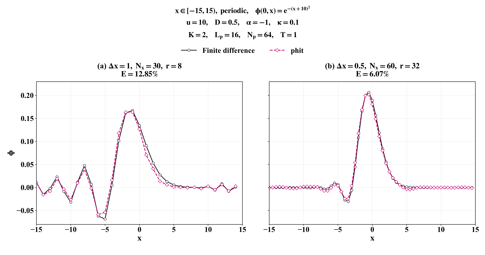

# Nonlinear Transport

Quantum-algorithm implementation for one-dimensional nonlinear advection–diffusion–reaction:

$$
\frac{\partial\phi}{\partial t}+u\frac{\partial\phi}{\partial x}
=D\frac{\partial^2\phi}{\partial x^2}+\alpha\phi+\kappa\phi^2.
$$

## Computational method

Second-order central differences discretise space. Carleman linearisation lifts the nonlinear system; Schrödingerisation uses a warped-phase transformation and FFT to construct Hermitian evolution problems. A second-order Suzuki–Trotter product advances the Pauli terms. An inverse FFT recovers the physical field at $p=0$.

The reference integrates the full nonlinear finite-difference system with Radau. Both solutions use the same spatial grid.

## Gaussian transport example

Periodic domain $x\in[-15,15)$ with $\phi(0,x)=e^{-(x+10)^2}$. Parameters: $u=10$, $D=0.5$, $\alpha=-1$, $\kappa=0.1$ and final time $T=1$. Carleman order $K=2$; auxiliary grid $L_p=16$, $N_p=64$.

*Real parts of the solutions. Relative $L_2$ errors, evaluated using the full complex recovered field, are 12.85% for $(N_x,r)=(30,8)$ and 6.07% for $(60,32)$.*

These are classical statevector simulations of the quantum algorithm. Spatial resolution and Trotter step count change together, so this comparison does not establish spatial convergence or quantum speedup.

[Run the code](RUNNING.md)
